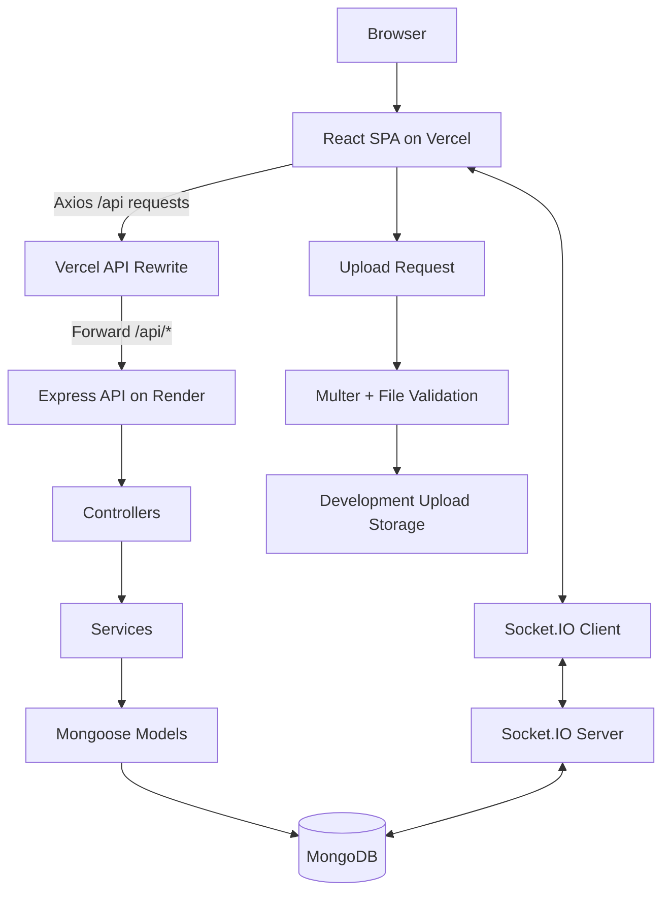
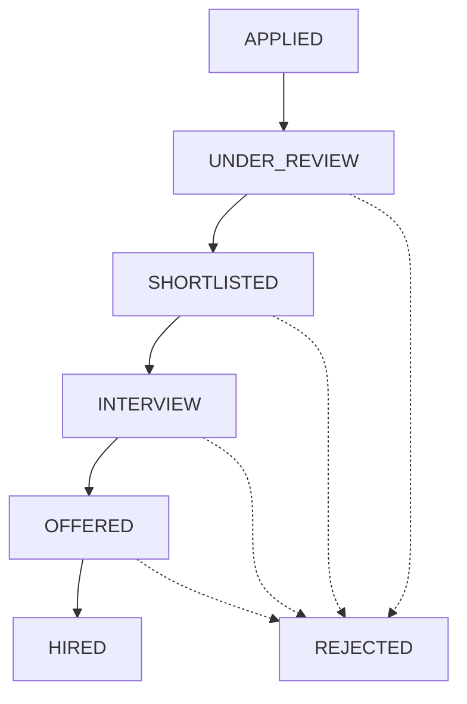

<!--
  HireFlow | MERN Recruitment Platform
  Author: Roshan Kumar (@itz-roshan)
  GitHub supports animated SVG images, badges, and Mermaid diagrams.
  External SVG animations require an internet connection to load.
-->

<div align="center">
  

  

  <br />

  <a href="https://hireflow-mern.vercel.app/"></a>
  <a href="https://github.com/itz-roshan/HireFlow-MERN"></a>
  <a href="https://hireflow-mern.vercel.app/api/health"></a>

  <br /><br />

  
  
  
  

  <br />

  <a href="https://github.com/itz-roshan"></a>
  
  
  

  <p><b>A full-stack hiring experience for job seekers, recruiters, and platform administrators.</b></p>

  <p>
    <a href="#-overview">Overview</a> ·
    <a href="#-features">Features</a> ·
    <a href="#-tech-stack">Tech Stack</a> ·
    <a href="#-architecture">Architecture</a> ·
    <a href="#-run-locally">Run Locally</a> ·
    <a href="#-author">Author</a>
  </p>
</div>

---

## 🌐 Deployment Links

| Service | Link |
|---|---|
| **Live frontend** | [hireflow-mern.vercel.app](https://hireflow-mern.vercel.app/) |
| **API through Vercel** | [hireflow-mern.vercel.app/api](https://hireflow-mern.vercel.app/api) |
| **API health check** | [ /api/health ](https://hireflow-mern.vercel.app/api/health) |
| **Direct backend API base** | [hireflow-mern.onrender.com/api](https://hireflow-mern.onrender.com/api) |
| **GitHub repository** | [itz-roshan/HireFlow-MERN](https://github.com/itz-roshan/HireFlow-MERN) |
| **Developer profile** | [github.com/itz-roshan](https://github.com/itz-roshan) |

> **Deployment note:** The repository's `vercel.json` rewrites `/api/*` requests to the Render backend. The links above reflect the configured deployment URLs; an endpoint may still be temporarily unavailable if the backend is starting or needs attention.

## 💡 Overview

**HireFlow** is a MERN recruitment platform that connects job seekers, recruiters, and administrators through a structured hiring process. It goes beyond a basic CRUD application by combining role-based workspaces, application tracking, interview scheduling, real-time messaging, notifications, and administrative moderation.

### ✨ At a glance

- 🔐 Role-aware registration, login, and protected workflows
- 💼 Job search, filtering, pagination, and saved jobs
- 📄 Candidate profiles, PDF resumes, and profile-photo uploads
- 🏢 Recruiter onboarding, company profiles, and job management
- 📊 Candidate pipeline and recruiter dashboard metrics
- 📅 Interview scheduling with overlap detection
- 💬 Private real-time messaging with Socket.IO
- 🔔 Notification center with unread counter and live updates
- 🛡️ Admin moderation, company verification, reports, and audit logs
- 📱 Responsive interface with loading, empty, and error states

## 🧩 Features

<details open>
  <summary><b>🧑‍💻 Job Seeker Workspace</b></summary>

  - Register and log in with role-based access.
  - Maintain a profile with headline, bio, phone, location, social links, skills, education, and experience.
  - Upload or replace a profile photo and PDF resume.
  - Track profile completion.
  - Discover and filter jobs by keyword, location, job type, and work mode.
  - Use pagination and shareable URL-based search state.
  - Save jobs and apply once per job with resume, cover letter, expected salary, and notice period.
  - Track application status and history, or withdraw open applications.
  - View interview information, receive notifications, and message recruiters privately.
</details>

<details>
  <summary><b>🏢 Recruiter Workspace</b></summary>

  - Register and complete company onboarding.
  - Manage recruiter profile and company details, including logo, website, description, and location.
  - Create, edit, publish, hide, and validate job listings.
  - Keep jobs with existing applications safe by hiding them instead of deleting them.
  - Search and filter applicants by status.
  - Review candidate details, resumes, and social links.
  - Move applications through review, shortlist, interview, offer, hire, or rejection.
  - Schedule interviews with overlap detection.
  - Receive notifications and communicate with candidates in real time.
  - View recruiter dashboard metrics.
</details>

<details>
  <summary><b>🛡️ Admin Workspace</b></summary>

  - View platform overview metrics.
  - Block or unblock users.
  - Review and manage company verification.
  - Moderate job visibility.
  - Review reports and update report status.
  - Inspect audit history for sensitive platform actions.
  - Manage the admin profile.
</details>

<details>
  <summary><b>⚡ Shared Platform Capabilities</b></summary>

  - Persistent recruiter/candidate conversations backed by MongoDB.
  - Socket.IO events for real-time messaging and notifications.
  - Private-conversation authorization and active-user checks.
  - HTTP-only cookie-based authentication and role-aware access.
  - Upload size limits, MIME allow-lists, and file-signature checks.
  - Application status history and database indexes for frequent lookups.
</details>

## 🧰 Tech Stack

| Layer | Technologies |
|---|---|
| Frontend | React, JavaScript, CSS |
| Backend | Node.js, Express.js |
| Database | MongoDB, Mongoose |
| API communication | REST API, Axios, HTTP-only cookies |
| Realtime | Socket.IO |
| Upload handling | Multer, MIME checks, file-signature validation |
| Local tooling | npm, Git, Docker Compose |
| CI | GitHub Actions |
| Deployment | Vercel (frontend/API proxy), Render (backend API) |

## 🏗️ Architecture



### 🔄 Application lifecycle



Recruiter status changes are recorded in application history so candidates can track their progress. The actual allowed transitions are controlled by the backend implementation.

## 🗂️ Project Structure

```text
HireFlow-MERN/
├── frontend/
│   └── src/
│       ├── api/
│       ├── components/       # Chat, jobs, profiles, notifications, dashboards, UI
│       ├── context/
│       ├── hooks/
│       ├── pages/            # Auth, public, candidate, recruiter, admin
│       ├── styles/
│       └── utils/
├── backend/
│   └── src/
│       ├── config/
│       ├── controllers/
│       ├── middleware/
│       ├── models/
│       ├── routes/
│       ├── services/
│       ├── utils/
│       └── validators/
├── docs/
├── scripts/
├── .github/workflows/ci.yml
├── docker-compose.yml
├── vercel.json
└── package.json
```

## 🗄️ Database Design

MongoDB/Mongoose models cover:

`Users` · `Companies` · `Jobs` · `Applications` · `Interviews` · `Notifications` · `Saved Jobs` · `Conversations` · `Messages` · `Reports` · `Audit Logs`

Indexes support common lookup patterns. Unique indexes help enforce identities such as emails, saved-job pairs, conversations, and job/applicant applications. **Mongoose's `unique` option configures a database index; it is not a validator on its own.** Ensure indexes are created in the target environment.

## 🚀 Run Locally

### Prerequisites

- [Node.js](https://nodejs.org/) 22 LTS or 24 LTS, compatible with the project dependencies
- [Git](https://git-scm.com/)
- MongoDB via Docker, local MongoDB Community Server, or MongoDB Atlas

### 1. Clone the repository

```bash
git clone https://github.com/itz-roshan/HireFlow-MERN.git
cd HireFlow-MERN
```

### 2. Start MongoDB

With Docker Compose:

```bash
docker compose up -d mongo
```

Alternatively, start MongoDB locally or configure MongoDB Atlas.

### 3. Install dependencies

```bash
npm install
```

### 4. Configure the backend

Copy `backend/.env.example` to `backend/.env` and set the environment variables required by the project. Local defaults include:

```env
MONGODB_URI=mongodb://127.0.0.1:27017/hireflow
CLIENT_URL=http://localhost:5173
```

Set any other required variables from the example file. Use your own strong secrets and **never commit `.env` files, tokens, or production credentials**.

### 5. Configure the frontend

Copy `frontend/.env.example` to `frontend/.env` and set the local API/socket URLs:

```env
VITE_API_URL=http://localhost:5000/api
VITE_SOCKET_URL=http://localhost:5000
```

### 6. Seed demo data and create indexes

```bash
npm run seed
npm run db:indexes
```

> ⚠️ Review the seed script before running it against an existing database. Development seed scripts can recreate or clear demo data.

### 7. Start the application

```bash
npm run dev
```

| Local service | URL |
|---|---|
| Frontend | [http://localhost:5173](http://localhost:5173) |
| Backend | [http://localhost:5000](http://localhost:5000) |
| API health check | [http://localhost:5000/api/health](http://localhost:5000/api/health) |
| Mongo Express, if configured | [http://localhost:8081](http://localhost:8081) |

## 🧪 Verification

Run the relevant checks from the repository root when MongoDB and required dependencies are available:

```bash
npm run dry-run
npm run doctor:db
npm run db:indexes
npm run seed
npm run smoke
npm run build
npm test
```

Before pushing changes, also run:

```bash
npm run check
npm run build --workspace frontend
```

`npm run smoke` requires the backend to be running and MongoDB to be available with seeded data. Check the [GitHub Actions workflow](https://github.com/itz-roshan/HireFlow-MERN/actions) for CI results. Do not describe the build as verified unless the relevant commands have completed successfully.

For the detailed clean-install and release sequence, see [`docs/RUN-AND-DRY-RUN.md`](docs/RUN-AND-DRY-RUN.md).

## 🔐 Upload Safety & Production Readiness

Development uploads are stored under `backend/uploads/` with server-generated filenames. The implementation includes file-size limits, MIME allow-lists, and file-signature checks. Uploaded binaries and local environment files should remain out of Git.

Before using the platform as a public production service:

- [ ] Use HTTPS and production-safe secrets.
- [ ] Use managed MongoDB with tested backups.
- [ ] Move uploads to S3, Cloudinary, or equivalent object storage with controlled access.
- [ ] Configure a real email provider for password reset and verification flows.
- [ ] Add unit, integration, and end-to-end tests.
- [ ] Configure structured logging, monitoring, and alerts.
- [ ] Review secure-cookie settings and CSRF protection for the deployment model.
- [ ] Review dependency vulnerabilities and update packages.
- [ ] Document privacy, consent, and data-retention rules.
- [ ] Remove or rotate all development/demo credentials.

## 🎨 UI & Design

- Plus Jakarta Sans for display text and DM Sans for body text.
- Responsive layouts with a consistent local CSS design system.
- Hover states, keyboard-focus indicators, and loading/empty/error states.
- CSS-based decorative motion that respects `prefers-reduced-motion`.

## 👨‍💻 Author

<div align="center">
  
  <br /><br />
  <a href="https://github.com/itz-roshan"></a>
  <a href="https://www.linkedin.com/in/itz-roshan/"></a>
  <br /><br />
  <b>Built with 💙 using the MERN stack</b>
  <br />
  <sub>MongoDB · Express.js · React · Node.js</sub>
</div>

<div align="center">
  
</div>
